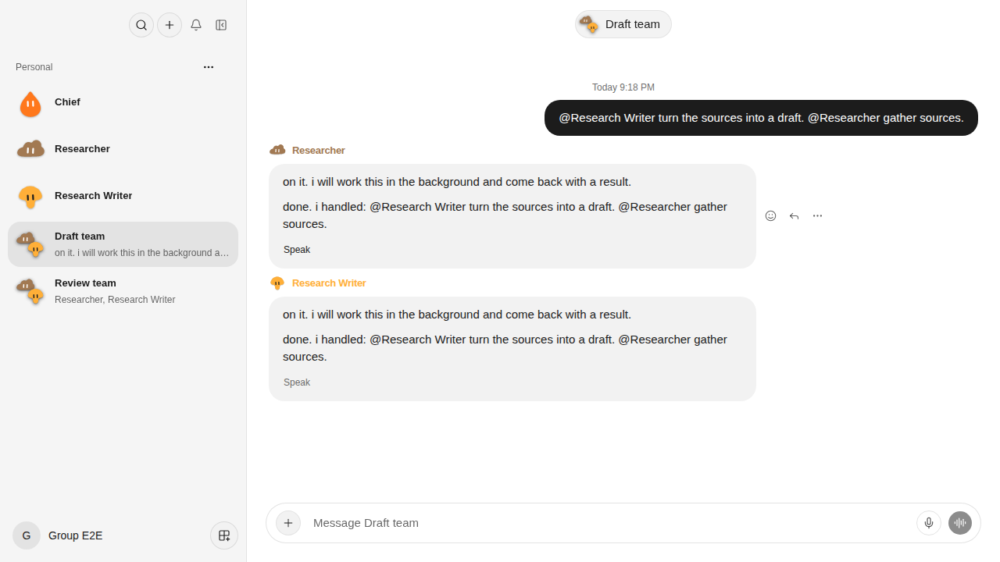
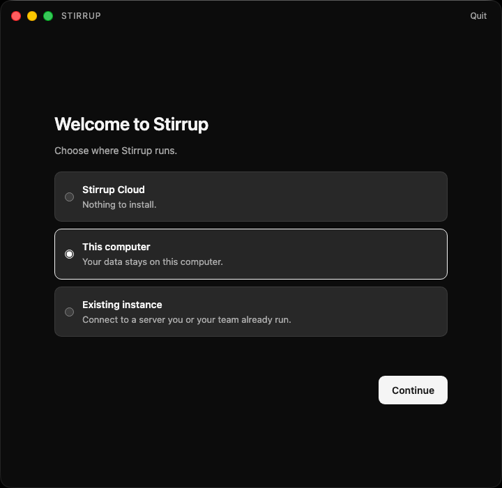
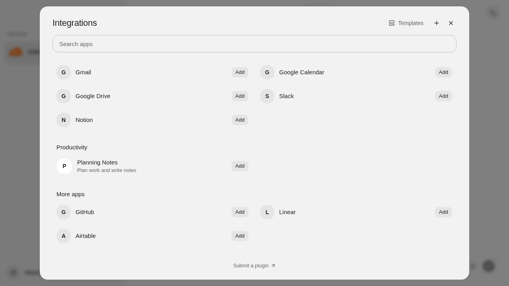

<p align="center">
  
</p>

# Stirrup by SaddleTree

**自分の AI チームを、自分のツールと環境で。**

Stirrup は、SaddleTree AI が開発するオープンソースの AI アシスタント用ワークスペースです。各アシスタントを **stirrup** と呼びます。役割を決め、モデルやツールを接続し、チャットで一緒に作業できます。文脈の記憶、ルーティンの実行、コンピューターの操作、グループでの共同作業に対応しています。

[Stirrup を開く](https://stirrup.saddletree.ai) · [ダウンロード](https://github.com/SaddleTreeAI/stirrup/releases/latest) · [セルフホスト](./docs/self-host.md) · [SaddleTree AI](https://saddletree.ai)

[English](./README.md) · [简体中文](./README.zh-CN.md) · [日本語](./README.ja.md) · [ไทย](./README.th-TH.md)



_画面内の会話は架空のデモデータです。[画像の出典](./docs/screenshots/stirrup/README.md)。_

## できること

- 役割ごとにアシスタントを作り、個別のチャットやグループで作業する。
- メモリ、定期実行、イベントをきっかけにしたルーティンを使う。
- ブラウザー、ターミナル、ファイルを扱い、必要なときに操作を引き継ぐ。
- アプリ、MCP サーバー、OpenAPI ツールを接続する。
- ドキュメントや共有可能なインタラクティブ Pages を作る。
- 対応するモデルサービスや互換性のあるローカルモデルを選び、自分の環境でサーバーを運用する。

利用できる機能は、設定したモデル、連携、コンピュータープロバイダーによって異なります。

## デスクトップとアプリ連携





Web、Electron デスクトップ、Expo モバイルクライアントは同じ Stirrup API に接続します。配布中のデスクトップ版は[このリポジトリのリリース](https://github.com/SaddleTreeAI/stirrup/releases/latest)を確認してください。モバイルのソースコードは同梱されていますが、ソースやベータ版の提供とアプリストアでの一般公開は別です。[モバイルのビルド](./docs/mobile-release.md)と[接続方法](./docs/self-host-clients.md)を参照してください。

## クイックスタート

Docker Engine 26+、Compose プラグイン、curl、OpenSSL が必要です。ソースの取得や Node.js のインストールは不要です。

```bash
mkdir -p stirrup && cd stirrup
curl -fsSLO https://raw.githubusercontent.com/SaddleTreeAI/stirrup/main/infra/compose/install-images.sh
bash install-images.sh
```

インストーラーが Compose ファイルを取得し、`.env` にランダムなシークレットを生成して起動します。再実行時は既存の `.env` を保持します。[localhost:5173](http://127.0.0.1:5173) を開き、アカウントを作成してモデルを接続し、最初の stirrup を作ってください。

標準の `edge` イメージは main に追従します。バージョン固定、ドメイン、HTTPS、バックアップについては[セルフホスト](./docs/self-host.md)と[本番運用](./docs/self-host-production.md)を参照してください。

## 開発とドキュメント

開発には Node.js 24.15+（24.x）または 26+、pnpm 12、Docker を使います。Node.js 25 は非対応です。[開発ガイド](./docs/development.md)に従い、データベースとシークレットを設定してから起動してください。

既存環境との互換性のため、一部のパッケージ名、環境変数、アプリ識別子には `rakazo` が残っています。設定にはドキュメントに記載された名前を使ってください。

- [詳しい英語版 README](./README.md)
- [モデル](./docs/self-host-models.md)、[連携](./docs/self-host-integrations.md)、[コンピュータープロバイダー](./docs/self-host-sandbox-providers.md)
- [バックアップ](./docs/self-host-backups.md)、[アップグレード](./docs/self-host-upgrading.md)、[監視](./docs/self-host-observability.md)
- [開発への参加](./CONTRIBUTING.md)、[脆弱性の報告](./SECURITY.md)、[リリースノート](./CHANGELOG.md)

## 上流プロジェクトとライセンス

Stirrup は SaddleTree AI による [Rakazo](https://github.com/elie222/rakazo) のフォークです。基盤を築いた上流のメンテナーと貢献者に感謝します。

コードは引き続き [Apache 2.0](./LICENSE) で提供され、第三者の著作権表示は [NOTICE](./NOTICE) に保持されています。
