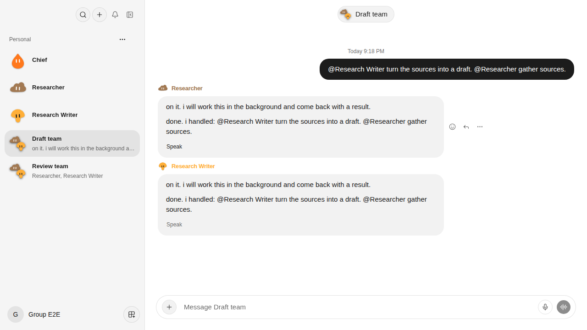
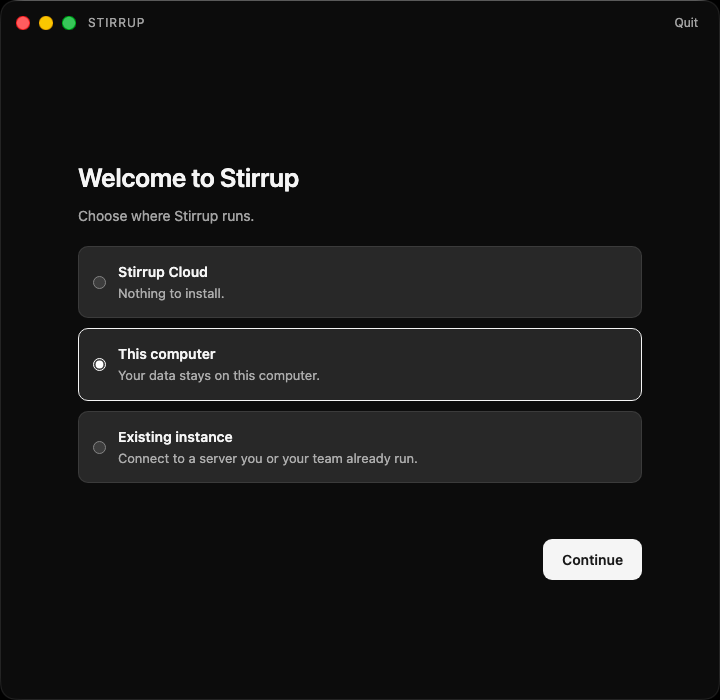
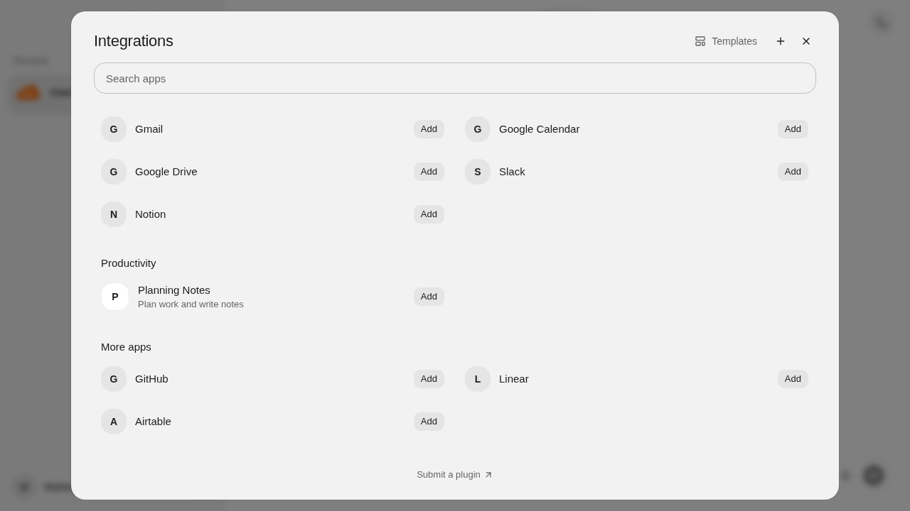

<p align="center">
  
</p>

# Stirrup by SaddleTree

**Your AI team. Your tools. Your infrastructure.**

Stirrup is SaddleTree AI’s open-source workspace for persistent AI assistants. We call each
assistant a **stirrup**: give it a role, connect a model and tools, and work with it in chat.
Stirrups can remember context, run routines, use a computer, and collaborate in groups.

[Open Stirrup](https://stirrup.saddletree.ai) · [Downloads](https://github.com/SaddleTreeAI/stirrup/releases/latest) · [Self-host](./docs/self-host.md) · [SaddleTree AI](https://saddletree.ai)

[English](./README.md) · [简体中文](./README.zh-CN.md) · [日本語](./README.ja.md) · [ไทย](./README.th-TH.md)



_Current Stirrup interface with fictional demo conversations. [Screenshot sources](./docs/screenshots/stirrup/README.md)._

## What you can do

- **Build a team.** Give stirrups different roles, keep separate conversations, or bring them into a group.
- **Keep work moving.** Use memory, scheduled routines, and event triggers for recurring work.
- **Work with a computer.** Give a stirrup a browser, terminal, and files; take control when needed.
- **Connect your tools.** Add app integrations, MCP servers, and OpenAPI tools.
- **Create and share.** Turn work into documents and interactive Pages.
- **Choose your setup.** Connect supported model providers or a compatible local model, and run the server on infrastructure you control.

Capabilities depend on the models, integrations, and computer providers you configure.

<table>
  <tr>
    <td width="50%" valign="top">
      <strong>A desktop that connects to your workspace</strong><br><br>
      
    </td>
    <td width="50%" valign="top">
      <strong>Your apps, in one place</strong><br><br>
      
    </td>
  </tr>
</table>

## Use Stirrup

- **Web:** open [stirrup.saddletree.ai](https://stirrup.saddletree.ai).
- **Desktop:** get the available installers from [this repository’s releases](https://github.com/SaddleTreeAI/stirrup/releases/latest). In setup, choose **Existing instance** to connect to your server, or **This computer** for local setup.
- **Mobile:** the Expo client is included in this repository. See the [mobile build guide](./docs/mobile-release.md) and [client connection guide](./docs/self-host-clients.md). Public app-store availability is separate from source and beta builds.

Web, desktop, and mobile connect to the same Stirrup API. A server can keep working while your
client is closed. Local desktop runtime requirements vary by platform; see the
[desktop guide](./docs/desktop-release.md) before building or distributing it.

## Quick start (published images)

You need Docker Engine 26+, the Compose plugin, curl, and OpenSSL. No source checkout or Node.js
installation is needed.

```bash
mkdir -p stirrup && cd stirrup
curl -fsSLO https://raw.githubusercontent.com/SaddleTreeAI/stirrup/main/infra/compose/install-images.sh
bash install-images.sh
```

The installer downloads the Compose files, generates secrets in `.env`, and starts the stack.
It preserves an existing `.env` when rerun. Open [localhost:5173](http://127.0.0.1:5173), create
an account, connect a model, and create your first stirrup.

The published `app`, `computer`, and `updater` images live under
`ghcr.io/saddletreeai/stirrup`. The default `edge` tag follows main; use a release tag for a
pinned installation. See [published images](./docs/self-host.md#published-images-no-checkout)
for configuration and supported architectures.

For a public server, configure your domain and HTTPS before exposing the app. Follow the
[production deployment guide](./docs/self-host-production.md), including backups and upgrades.
For an agent-assisted setup, use [SETUP_PROMPT.md](./SETUP_PROMPT.md).

## Local development (source checkout)

Use Node.js 24.15+ in the 24.x line or Node.js 26+, pnpm 12, and Docker. Node.js 25 is not supported.

```bash
git clone https://github.com/SaddleTreeAI/stirrup.git
cd stirrup
cp .env.example .env
```

Before starting, configure the database URLs and independent authentication, encryption,
screen-proxy, and sandbox-supervisor secrets. The [development guide](./docs/development.md)
walks through the required values, optional integrations, ports, and local networking.

```bash
pnpm install
pnpm sandbox:build
pnpm dev
```

Open the URL printed by `pnpm dev`. To work on the Electron client, connect it to that instance:

```bash
pnpm --filter @rakazo/desktop dev
```

Some package names, environment variables, and application identifiers retain `rakazo` for
compatibility with existing installations. Use the documented names when configuring the app.

```text
apps/       web, API, worker, desktop, mobile, and website
packages/   shared domain logic, contracts, persistence, adapters, and UI
infra/      services and computer images
docs/       setup, architecture, operations, and release guides
```

Read [CONTRIBUTING.md](./CONTRIBUTING.md) for the development workflow and checks.

## Documentation

- [Self-hosting](./docs/self-host.md) and [configuration](./docs/self-host-configuration.md)
- [Models](./docs/self-host-models.md) and [integrations](./docs/self-host-integrations.md)
- [Computer providers](./docs/self-host-sandbox-providers.md) and [runtime isolation](./docs/computer-runtime.md)
- [Accounts](./docs/self-host-accounts.md), [secrets](./docs/self-host-secrets.md), and [storage](./docs/self-host-storage.md)
- [Backups](./docs/self-host-backups.md), [upgrades](./docs/self-host-upgrading.md), and [monitoring](./docs/self-host-observability.md)
- [Desktop releases](./docs/desktop-release.md) and [mobile releases](./docs/mobile-release.md)
- [Brand assets](https://stirrup.saddletree.ai/brand/) and [release notes](./CHANGELOG.md)

## Contributing and security

Bug reports and focused pull requests are welcome. Start with
[CONTRIBUTING.md](./CONTRIBUTING.md). Report vulnerabilities through
[SECURITY.md](./SECURITY.md), rather than a public issue.

## Upstream and license

Stirrup is SaddleTree AI’s fork of [Rakazo](https://github.com/elie222/rakazo).
Thanks to the upstream maintainers and contributors for the foundation this project builds on.

The code remains licensed under [Apache 2.0](./LICENSE). Third-party attribution is preserved
in [NOTICE](./NOTICE).
