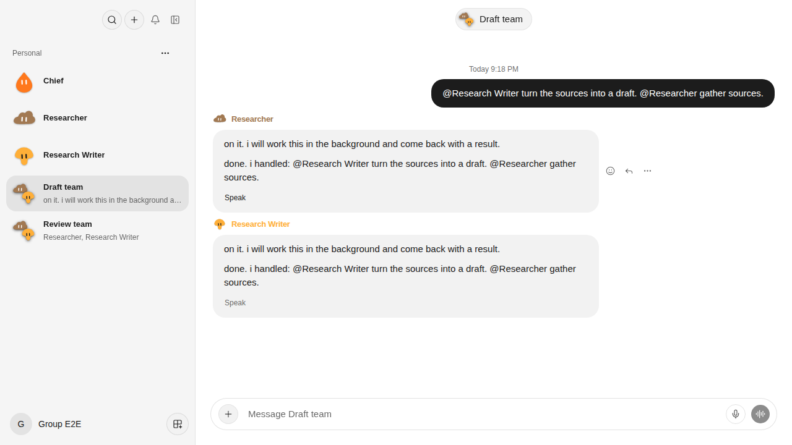
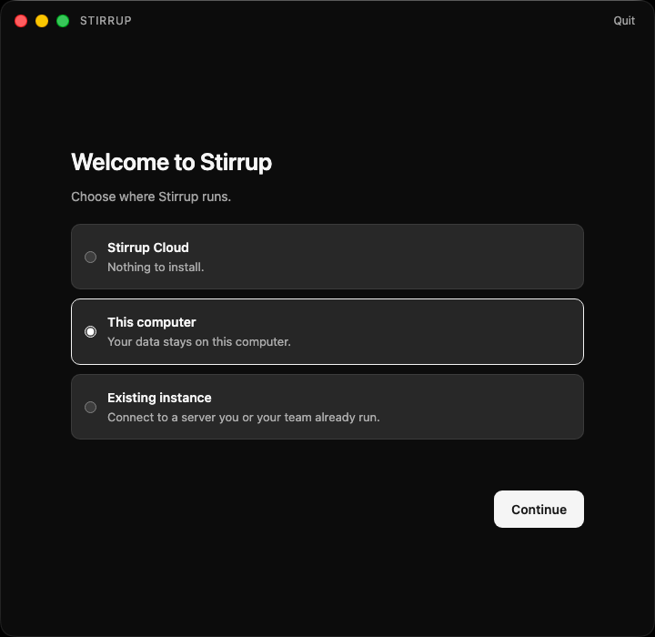
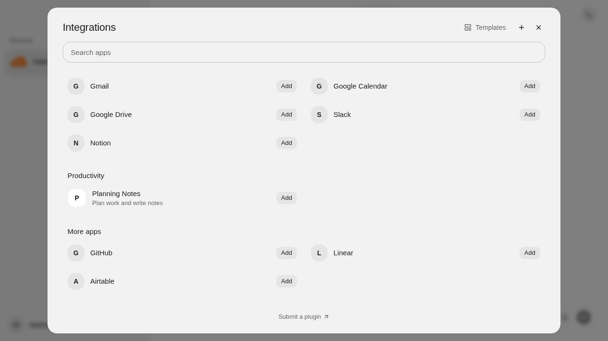

<p align="center">
  
</p>

# Stirrup by SaddleTree

**ทีม AI ของคุณ เครื่องมือของคุณ โครงสร้างพื้นฐานของคุณ**

Stirrup คือเวิร์กสเปซโอเพนซอร์สของ SaddleTree AI สำหรับผู้ช่วย AI ที่ทำงานต่อเนื่อง เราเรียกผู้ช่วยแต่ละตัวว่า **stirrup** คุณกำหนดบทบาท เชื่อมต่อโมเดลและเครื่องมือ แล้วทำงานร่วมกันผ่านแชตได้ ผู้ช่วยสามารถจดจำบริบท ทำงานตามกิจวัตร ใช้คอมพิวเตอร์ และทำงานร่วมกันในกลุ่ม

[เปิด Stirrup](https://stirrup.saddletree.ai) · [ดาวน์โหลด](https://github.com/SaddleTreeAI/stirrup/releases/latest) · [ติดตั้งเอง](./docs/self-host.md) · [SaddleTree AI](https://saddletree.ai)

[English](./README.md) · [简体中文](./README.zh-CN.md) · [日本語](./README.ja.md) · [ไทย](./README.th-TH.md)



_ภาพใช้บทสนทนาสมมติสำหรับสาธิต [ที่มาของภาพ](./docs/screenshots/stirrup/README.md)_

## ทำอะไรได้บ้าง

- สร้างผู้ช่วยตามบทบาท ใช้แชตแยกหรือจัดเป็นทีม
- ใช้ความจำ งานตามตาราง และเหตุการณ์ที่กระตุ้นการทำงาน
- ให้ผู้ช่วยใช้เบราว์เซอร์ เทอร์มินัล และไฟล์ พร้อมรับช่วงควบคุมเมื่อจำเป็น
- เชื่อมต่อแอป เซิร์ฟเวอร์ MCP และเครื่องมือ OpenAPI
- สร้างเอกสารและ Pages แบบโต้ตอบที่แชร์ได้
- เลือกผู้ให้บริการโมเดลที่รองรับหรือโมเดล local ที่เข้ากันได้ และรันเซิร์ฟเวอร์บนระบบของคุณ

ความสามารถขึ้นอยู่กับโมเดล การเชื่อมต่อ และผู้ให้บริการคอมพิวเตอร์ที่ตั้งค่าไว้

## เดสก์ท็อปและการเชื่อมต่อแอป





เว็บ แอป Electron และแอปมือถือ Expo ใช้ Stirrup API เดียวกัน ดาวน์โหลดตัวติดตั้งเดสก์ท็อปที่มีให้จาก[หน้า releases ของ repo นี้](https://github.com/SaddleTreeAI/stirrup/releases/latest) ซอร์สแอปมือถืออยู่ใน repo แต่การมีซอร์สหรือรุ่นเบต้าไม่ได้หมายความว่าเปิดให้ดาวน์โหลดในร้านแอปแล้ว ดู[คู่มือ build มือถือ](./docs/mobile-release.md)และ[คู่มือเชื่อมต่อ](./docs/self-host-clients.md)

## เริ่มใช้งาน

ต้องมี Docker Engine 26+, Compose plugin, curl และ OpenSSL ไม่ต้อง clone ซอร์สหรือติดตั้ง Node.js

```bash
mkdir -p stirrup && cd stirrup
curl -fsSLO https://raw.githubusercontent.com/SaddleTreeAI/stirrup/main/infra/compose/install-images.sh
bash install-images.sh
```

ตัวติดตั้งจะดาวน์โหลดไฟล์ Compose สร้าง secret แบบสุ่มใน `.env` และเริ่มระบบ โดยเก็บ `.env` เดิมเมื่อรันซ้ำ เปิด [localhost:5173](http://127.0.0.1:5173) สร้างบัญชี เชื่อมต่อโมเดล แล้วสร้าง stirrup ตัวแรก

อิมเมจ `edge` ติดตาม main หากต้องการตรึงเวอร์ชัน ตั้งค่าโดเมน HTTPS หรือสำรองข้อมูล ดู[คู่มือติดตั้งเอง](./docs/self-host.md)และ[คู่มือ production](./docs/self-host-production.md)

## การพัฒนาและเอกสาร

ใช้ Node.js 24.15+ ในสาย 24.x หรือ 26+, pnpm 12 และ Docker ไม่รองรับ Node.js 25 ทำตาม[คู่มือพัฒนา](./docs/development.md)เพื่อตั้งค่าฐานข้อมูลและ secret ก่อนเริ่มระบบ

ชื่อแพ็กเกจ ตัวแปรสภาพแวดล้อม และรหัสแอปบางส่วนยังใช้ `rakazo` เพื่อให้เข้ากับการติดตั้งเดิมได้ โปรดใช้ชื่อตามเอกสารเมื่อตั้งค่า

- [README ภาษาอังกฤษฉบับเต็ม](./README.md)
- [โมเดล](./docs/self-host-models.md) [การเชื่อมต่อ](./docs/self-host-integrations.md) และ[ผู้ให้บริการคอมพิวเตอร์](./docs/self-host-sandbox-providers.md)
- [การสำรองข้อมูล](./docs/self-host-backups.md) [การอัปเกรด](./docs/self-host-upgrading.md) และ[การติดตามระบบ](./docs/self-host-observability.md)
- [การมีส่วนร่วม](./CONTRIBUTING.md) [รายงานช่องโหว่](./SECURITY.md) และ[บันทึกรุ่น](./CHANGELOG.md)

## ต้นทางและสัญญาอนุญาต

Stirrup เป็น fork ของ [Rakazo](https://github.com/elie222/rakazo) โดย SaddleTree AI ขอบคุณผู้ดูแลและผู้ร่วมพัฒนาโครงการต้นทาง

โค้ดยังคงใช้สัญญาอนุญาต [Apache 2.0](./LICENSE) และเก็บประกาศของบุคคลที่สามไว้ใน [NOTICE](./NOTICE)
