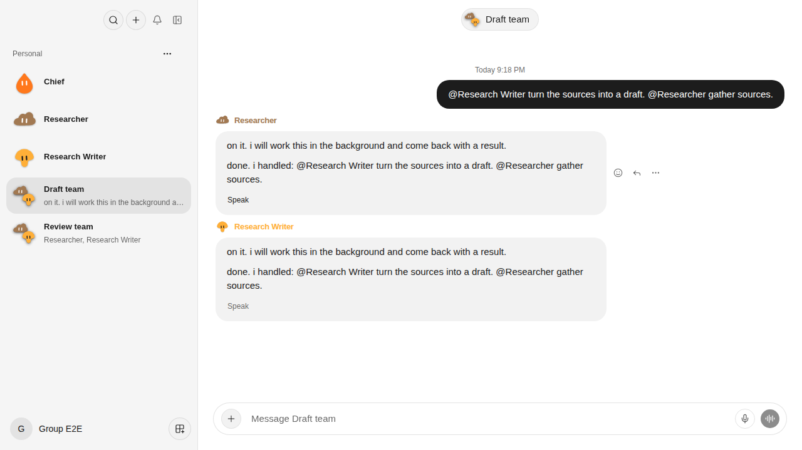
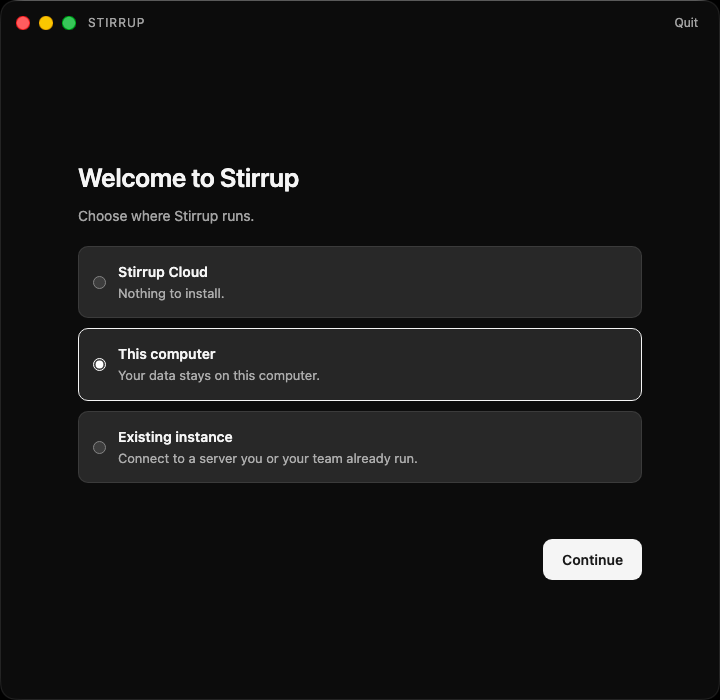
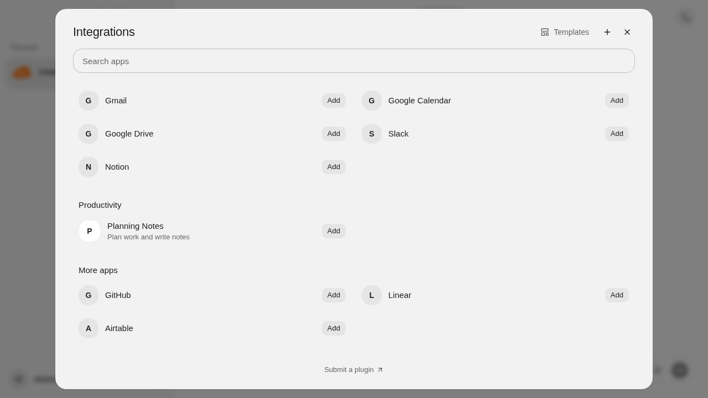

<p align="center">
  
</p>

# Stirrup by SaddleTree

**你的 AI 团队，你的工具，你的基础设施。**

Stirrup 是 SaddleTree AI 的开源 AI 助手工作空间。我们把每个助手称为 **stirrup**：为它分配角色、连接模型和工具，然后通过聊天协作。Stirrup 可以记住上下文、执行例行任务、使用计算机，并在群组中协作。

[打开 Stirrup](https://stirrup.saddletree.ai) · [下载](https://github.com/SaddleTreeAI/stirrup/releases/latest) · [自托管](./docs/zh-CN/self-host.md) · [SaddleTree AI](https://saddletree.ai)

[English](./README.md) · [简体中文](./README.zh-CN.md) · [日本語](./README.ja.md) · [ไทย](./README.th-TH.md)



_截图使用虚构的演示对话。[截图来源](./docs/screenshots/stirrup/README.md)。_

## 主要功能

- 为不同角色创建助手，单独聊天或组建团队。
- 通过记忆、定时任务和事件触发器处理持续工作。
- 使用浏览器、终端和文件，并在需要时接管计算机。
- 连接应用、MCP 服务器和 OpenAPI 工具。
- 创建文档和可分享的交互式 Pages。
- 选择受支持的模型服务或兼容的本地模型，在自己的基础设施上运行服务器。

具体能力取决于配置的模型、集成和计算机服务。

## 桌面与应用连接





网页、Electron 桌面客户端和 Expo 移动客户端使用同一个 Stirrup API。桌面安装包以[本仓库的发行版](https://github.com/SaddleTreeAI/stirrup/releases/latest)为准。移动客户端源码已包含在仓库中；源码和测试版不代表已在应用商店公开上架。详见[移动构建指南](./docs/mobile-release.md)和[客户端连接指南](./docs/self-host-clients.md)。

## 快速开始

需要 Docker Engine 26+、Compose 插件、curl 和 OpenSSL，无需克隆源码或安装 Node.js。

```bash
mkdir -p stirrup && cd stirrup
curl -fsSLO https://raw.githubusercontent.com/SaddleTreeAI/stirrup/main/infra/compose/install-images.sh
bash install-images.sh
```

安装程序会下载 Compose 文件，在 `.env` 中生成随机密钥并启动服务；再次运行时保留已有 `.env`。打开 [localhost:5173](http://127.0.0.1:5173)，创建账户、连接模型，然后创建第一个 stirrup。

默认 `edge` 镜像跟随主分支。固定版本、域名、HTTPS 和备份设置请参阅[自托管指南](./docs/zh-CN/self-host.md)及[生产部署指南](./docs/self-host-production.md)。

## 开发与文档

源码开发需要 Node.js 24.15+（24.x）或 26+、pnpm 12 和 Docker；不支持 Node.js 25。请按照[开发指南](./docs/development.md)配置数据库和密钥，再运行项目。

部分包名、环境变量和应用标识符保留 `rakazo`，以兼容现有安装；配置时请使用文档中的准确名称。

- [完整英文说明](./README.md)
- [模型](./docs/zh-CN/self-host-models.md)、[集成](./docs/self-host-integrations.md)与[计算机服务](./docs/self-host-sandbox-providers.md)
- [备份](./docs/zh-CN/self-host-backups.md)、[升级](./docs/zh-CN/self-host-upgrading.md)与[受限网络](./docs/zh-CN/self-host-restricted-network.md)
- [贡献指南](./CONTRIBUTING.md)、[安全报告](./SECURITY.md)与[发行说明](./CHANGELOG.md)

## 上游与许可证

Stirrup 是 SaddleTree AI 基于 [Rakazo](https://github.com/elie222/rakazo) 的分支。感谢上游维护者和贡献者。

代码继续采用 [Apache 2.0](./LICENSE) 许可证，第三方署名保留在 [NOTICE](./NOTICE) 中。
